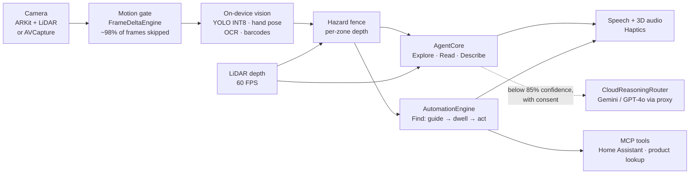

# EchoGuide

**A real-time, multimodal visual agent for blind and low-vision people.** It watches through the phone camera continuously, reasons about what matters, and acts on its own: it names what comes into view, warns before you walk into something, reads what's in front of you, and guides your finger onto the exact button you need, then presses it. It runs on the phone, works in Airplane Mode, and needs no screen.

> Not a medical device and not FDA approved. Currently for testing only.

## The problem

At least [2.2 billion people have a vision impairment](https://www.who.int/news/item/08-10-2019-who-launches-first-world-report-on-vision) (WHO, 2019). AI vision apps for them have improved, but they share one shape: **you point the camera and ask, and it answers.** That leaves three everyday problems unsolved:

1. **The last 10 cm.** Knowing a microwave "has a Start button" doesn't help if you can't find it. Flat touch panels have no tactile edges.
2. **Things you didn't know to ask about.** The chair in the corridor, the sign on the door. A question-answer app stays silent until you ask.
3. **No signal, no help.** Cloud-first assistants stop working in a basement, on the underground, or in Airplane Mode.

## What it does

| Mode | What you hear or feel | Runs on |
|---|---|---|
| **Explore** (default) | Speaks up on its own: *"A chair, on your left, about 2 meters."* *"Obstacle ahead, very close"* plus a buzz. *"Sign: EXIT."* It names each thing once, important things first, and never chatters. | Phone |
| **Find** | Say or type a goal (*"start button"*). Haptic pulses speed up as your finger closes in, a double tap means you're on it, and holding still presses it through a smart-home plugin. | Phone |
| **Read** | Reads text in reading order, each line once, as you move the camera. | Phone |
| **Describe** | One tap: a few sentences about everything in view. Uses a multimodal model with the photo when you allow it, otherwise an on-device summary. | Cloud or phone |

Hazard warnings (*"Careful. Hob is close."* / *"Stop. Hob."*) work in every mode. First launch is a spoken seven-step setup with a hands-on haptic demo, and only the camera is required.

## What's new here

1. **Closed-loop haptic guidance onto a target, with dwell-to-act.** A fully local loop (7.9 ms from frame to cue on an M4; phone numbers pending) tracks the fingertip ([`LocalVisionEngine`](EchoGuide/Core/Vision/LocalVisionEngine.swift)) against one isolated target ([`CognitiveTaskIsolation`](EchoGuide/Core/Cognitive/CognitiveTaskIsolation.swift)). Pulse rate encodes distance, sharpness encodes up or down, and spatial audio encodes left or right ([`SpatialHapticEngine`](EchoGuide/Core/Haptics/SpatialHapticEngine.swift)). Holding on target is the confirmation gesture for physical actions ([`AutomationEngine`](EchoGuide/Core/Automation/AutomationEngine.swift)). Describing a scene is common; leading a hand onto a flat control and pressing it is not.
2. **Proactive narration as a policy, not a prompt.** [`SceneNarrator`](EchoGuide/Core/Agent/SceneNarrator.swift) decides *when to speak*: things must be settled across frames, each is named once per cooldown, they're ranked by salience (an obstacle in the path, then vehicles, then people, then furniture), there's a minimum gap between sentences, and every sentence carries place and LiDAR distance. Only an obstacle may interrupt. The decision costs about a microsecond per frame.
3. **A motion-gated, back-pressured perception pipeline.** [`FrameDeltaEngine`](EchoGuide/Core/Camera/FrameDeltaEngine.swift) samples 768 points per frame with auto-exposure compensation, so most frames never reach a model. [`PerceptionPipeline`](EchoGuide/Core/Camera/PerceptionPipeline.swift) keeps at most one inference in flight and drops rather than queues, so latency can't pile up. Dropped motion forces the next frame through, so it is never lost.
4. **Local-first multimodal routing that degrades gracefully.** [`CloudReasoningRouter`](EchoGuide/Core/Router/CloudReasoningRouter.swift) answers locally above 85% confidence. Below that, it uses a cloud model under a hard deadline, a failure cutoff that stops retrying a failing provider, a cost cap and photo consent. Otherwise it falls back to an on-device scene summary ([`SceneSummary`](EchoGuide/Core/Agent/AgentCore.swift)). Offline never means silent.
5. **Seeing turns into doing, through MCP.** [`PluginRegistry`](EchoGuide/Core/Plugins/PluginRegistry.swift) maps recognised things (a label, the word "START", a barcode) to Model Context Protocol tools: Home Assistant appliance control and barcode product lookup ([`BuiltInPlugins`](EchoGuide/Core/Plugins/BuiltInPlugins.swift)). It also serves and consumes MCP over JSON-RPC, so any FastMCP server becomes a new capability, configured per home with no code change.
6. **Measurement built in.** A reproducible benchmark suite ([`EchoGuideBench`](EchoGuideBench/main.swift)), an in-app speed test, and an in-app trial recorder with a fixed task battery and CSV export ([`TrialRecorder`](EchoGuide/Core/Agent/TrialRecorder.swift), [`benchmarks/PROTOCOL.md`](benchmarks/PROTOCOL.md)).

## Measured

Produced by `swift run -c release EchoGuideBench`. This runs the shipping engine code, including Apple's Vision framework, with nothing mocked except the input images. Full report: [`benchmarks/results/Mac16,13.md`](benchmarks/results/Mac16,13.md).

| Measure (Apple M4) | Result |
|---|---|
| Camera frame → spoken sentence, full path on real Vision | **7.9 ms** p50 · 8.6 ms p95 |
| Hand pose + text + barcode, one pass | **8.8 ms** p50 · 11.3 ms p95 |
| Frames that never reach a model (60 s, mostly still scene) | **98.4%** |
| Motion gate per 1920×1440 frame | **3 µs** |
| Agent decision (detections in → what to say) | **6.6 µs** |
| Button labels read / barcode decoded (synthetic panel) | 100% / 100% |

**Phone numbers** come from the in-app speed test (Settings → Measure on-device speed) and are added here once measured on an A17-class iPhone. Recognition rates above use rendered labels in perfect light, so treat them as an upper bound, not field accuracy. Field results go through [`benchmarks/PROTOCOL.md`](benchmarks/PROTOCOL.md).

## Architecture

Deep dive, covering the threading and back-pressure model, the latency budget, coordinate conventions, each state machine, and the safety rules: [`docs/ARCHITECTURE.md`](docs/ARCHITECTURE.md).

## Try it

| Path | Steps |
|---|---|
| **TestFlight** | Run the `ios-release` workflow (Actions tab). It exports and bundles the object model, archives with cloud signing, and uploads. Secrets are listed at the top of [`ios-release.yml`](.github/workflows/ios-release.yml). |
| **Xcode** | Open `EchoGuideApp/EchoGuideApp.xcodeproj`, pick your team, and run on an iPhone (LiDAR models get depth). |
| **Engine only** | `swift test` (112 tests) and `swift run -c release EchoGuideBench` on any Mac. |
| **Backend** | `cd proxy && node --test`. Deploy with [`infra/freestyle`](infra/freestyle/README.md) or any Node host. |

## Repository map

| Path | What | Owner |
|---|---|---|
| `EchoGuide/Core/Contracts` | Shared types and protocols; the only coupling between engines | Both |
| `EchoGuide/Core/Camera`, `Vision`, `Depth` | Camera feed, motion gate, pipeline, on-device vision, LiDAR | Maxwell |
| `EchoGuide/Core/Agent` | Visual agent: Explore, Read, Describe, narrator, trial recorder | Maxwell |
| `EchoGuide/Core/Router`, `Plugins` | Cloud routing, voice loop, MCP registry, built-in tools | Maxwell |
| `EchoGuide/Core/Automation`, `Cognitive` | Find mode state machine, one-target isolation | Bryan |
| `EchoGuide/Core/Haptics`, `Audio`, `Fence` | Haptic guidance, spatial audio and speech, hazard fence | Bryan |
| `EchoGuide/UI` | Find-mode guidance view | Bryan |
| `EchoGuideApp` | The iOS app: onboarding, live screen, settings, benchmark lab | Maxwell |
| `EchoGuideBench`, `benchmarks` | Benchmark suite, results, head-to-head protocol | Maxwell |
| `proxy`, `infra` | Key-holding proxy (zero-dependency Node), demo deploy | Maxwell, Bryan |

Engines import only `EchoGuideContracts`, never each other, and the app composes them in one file ([`AppRuntime.swift`](EchoGuideApp/Sources/AppRuntime.swift)). That's why two people could build this in parallel without merge conflicts. Ownership is enforced by [`CODEOWNERS`](.github/CODEOWNERS).

## Engineering

- **112 Swift tests + 6 proxy tests**, run on every push. CI also compiles the iOS-only code (ARKit, CoreHaptics, camera) and the full app for the iOS Simulator.
- **No third-party Swift dependencies.** Apple frameworks only: Vision, Core ML, ARKit, CoreHaptics, AVFoundation, Speech.
- **Zero-dependency Node proxy:**
  - device tokens are stored only as SHA-256 hashes
  - per-device rate limits, a model allow-list and output caps
  - 30-second speech tokens, so long-lived keys never reach the phone

## Privacy and safety

- Video stays on the phone. A photo is sent only when you tap Describe, and only with consent given in onboarding or Settings. API keys live only in the proxy.
- Any physical action needs a deliberate 0.8 s hold on target, and a hazard breach cancels a hold in progress.
- The object model is Ultralytics YOLO11n, licensed **AGPL-3.0**. That's fine for testing; a public release needs an Ultralytics license or a permissively licensed detector.

## Status

Built and tested end to end in CI. **Not yet run on a phone at scale**: on-device numbers and field trials are next. Not built yet: a carer-side setup flow (per-home config is a JSON file today) and multi-turn conversation through the OpenAI Realtime API.
